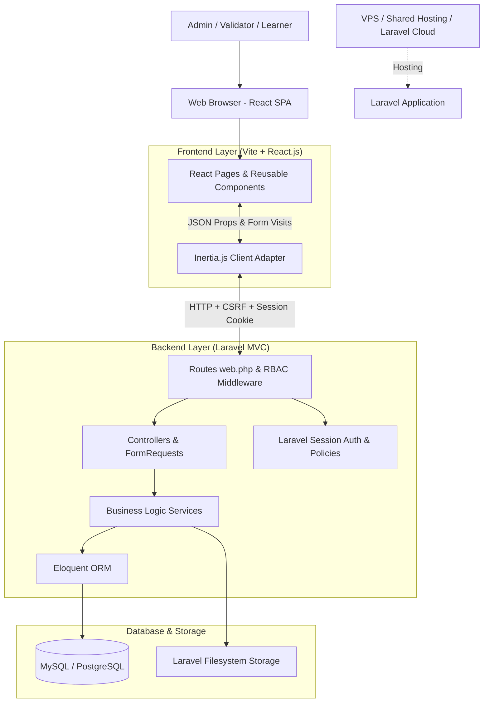

# ARCHITECTURE.md — Pasanku

Dokumen ini menjelaskan arsitektur sistem, struktur proyek **Laravel + Inertia.js + React.js**, pemisahan tanggung jawab lapisan kode, keamanan RBAC dan Inertia props, serta prinsip transaksi database untuk aplikasi web **PASANKU**.

---

## 1. Prinsip Perancangan

- **Modern Monolithic Application:** Seluruh modul (Learner, Validator, Admin, dan Mode Pratinjau) dikembangkan dalam satu proyek Laravel dengan React sebagai lapisan tampilan melalui Inertia.js, tanpa REST API terpisah.
- **Separation of Concerns:** Memisahkan lapisan Presentasi (`resources/js/Pages` & `Components`), Pengendalian Rute & Validasi (`Routes`, `Middleware`, `FormRequests`, `Controllers`), Logika Bisnis (`Services`), dan Akses Data (`Eloquent Models`).
- **Database-Driven Content:** Kurikulum, urutan aktivitas, kosakata, soal, dan kunci jawaban tersimpan secara relasional di database.
- **Role-Based Access Control (RBAC):** Seluruh hak akses diperiksa di sisi server menggunakan Middleware, Policy, dan Gate.
- **Server-Side Validation & Scoring:** Pemeriksaan jawaban, penghitungan skor, penetapan kelulusan, rekomendasi remedial, pembukaan unit, dan pemberian XP wajib berjalan di sisi server dalam transaksi atomik.

---

## 2. Arsitektur Sistem Umum



---

## 3. Struktur Direktori Proyek

```text
pasanku/
├── app/
│   ├── Enums/                          # Enum PHP (UserRole, ContentStatus, QuestionType [4 tipe], ActivityType)
│   ├── Http/
│   │   ├── Controllers/
│   │   │   ├── Auth/                   # LoginController, RegisterController, LogoutController
│   │   │   ├── Learner/
│   │   │   │   ├── LearningPathController.php
│   │   │   │   ├── LessonController.php
│   │   │   │   ├── QuizController.php
│   │   │   │   ├── DictionaryController.php
│   │   │   │   ├── LeaderboardController.php
│   │   │   │   └── ProfileController.php
│   │   │   ├── Validator/
│   │   │   │   ├── ReviewQueueController.php
│   │   │   │   ├── ReviewDetailController.php
│   │   │   │   ├── ReviewHistoryController.php
│   │   │   │   └── ReferenceDictionaryController.php
│   │   │   ├── Admin/
│   │   │   │   ├── DashboardController.php
│   │   │   │   ├── UnitController.php
│   │   │   │   ├── LessonBuilderController.php
│   │   │   │   ├── QuizController.php
│   │   │   │   └── ValidatorManagementController.php
│   │   │   └── PreviewController.php   # Mode Pratinjau stateless (Admin & Validator)
│   │   ├── Middleware/
│   │   │   ├── HandleInertiaRequests.php # Shared props (auth, role, totalXp, flash)
│   │   │   └── EnsureUserHasRole.php     # Pemeriksaan peran & status is_active
│   │   └── Requests/                   # Form Request validation per aksi
│   ├── Models/                         # Eloquent Models (25 entitas tabel)
│   ├── Policies/                       # Policy otorisasi (LessonPolicy, QuizPolicy, ReviewPolicy, dll.)
│   └── Services/
│       ├── AccessControlService.php    # Aturan akses Unit, Lesson berurutan, dan pemblokiran Quiz
│       ├── ContentValidationService.php# Workflow pengajuan, review, publikasi, & content_version
│       ├── ScoringService.php          # Penilaian 4 tipe soal (termasuk penilaian parsial mencocokkan)
│       ├── LearningService.php         # Percobaan lesson reguler/remedial, progres, & kelulusan
│       ├── QuizService.php             # Percobaan quiz, penilaian, & pembukaan unit berikutnya
│       ├── RecommendationService.php   # Algoritma rekomendasi remedial berbasis kesalahan quiz
│       └── GamificationService.php     # Pemberian XP anti-duplikasi, perhitungan Level & Badge
├── database/
│   ├── migrations/                     # Skema seluruh tabel relasional
│   └── seeders/                        # InitialAdminSeeder, InitialCurriculumSeeder, BadgeSeeder
├── public/
│   └── images/                         # pasanku_logo_cream.png, pasanku_logo_full.png, pasanku_app_icon.png
├── resources/
│   ├── css/
│   │   └── app.css                     # Token @theme Tailwind v4, efek taktil 3D, animasi MOTION 1
│   ├── js/
│   │   ├── app.jsx                     # Entry point Inertia + React
│   │   ├── Layouts/
│   │   │   ├── GuestLayout.jsx         # Landing, Login, Register
│   │   │   ├── AppLayout.jsx           # Navigasi responsif per peran (Bottom Nav 4 tab / Sidebar / Rail)
│   │   │   └── FocusLayout.jsx         # Kanvas fokus Lesson & Quiz (maks 960px, tanpa nav global)
│   │   ├── Components/
│   │   │   ├── UI/                     # TactileButton, WovenDivider, ProgressBar, PageSkeleton, EmptyState, ErrorState
│   │   │   └── Questions/              # MultipleChoice, MatchingPairs, FillBlank
│   │   └── Pages/
│   │       ├── Welcome.jsx
│   │       ├── Auth/                   # Login.jsx, Register.jsx
│   │       ├── Learner/                # LearningPath, LessonPlayer, QuizPlayer, Dictionary, Leaderboard, Profile
│   │       ├── Validator/              # ReviewQueue, ReviewDetail, ReviewHistory, ReferenceDictionary
│   │       ├── Admin/                  # Dashboard, Units, LessonBuilder, Quizzes, Validators
│   │       └── Preview/                # PreviewPath, PreviewLesson, PreviewQuiz
│   └── views/
│       └── app.blade.php               # Root HTML tunggal (@viteReactRefresh, @vite, @routes, @inertia)
├── routes/
│   └── web.php                         # Seluruh rute aplikasi web dengan grup middleware RBAC
└── tests/
    ├── Unit/                           # Tes ScoringService, RecommendationService, GamificationService
    └── Feature/                        # Tes RBAC, Auth, Content Validation, Learning, Quiz, Preview (assertInertia)
```

---

## 4. Pembagian Lapisan Logika (Service Layer)

Controller Laravel dibuat tipis (*thin controllers*): hanya memvalidasi permintaan, memeriksa Policy, memanggil Service Class, dan mengembalikan `Inertia::render(...)` atau `redirect()->back()`. Seluruh aturan bisnis kritis ditempatkan di `app/Services/`:

| Service Class | Tanggung Jawab Utama |
| --- | --- |
| `AccessControlService` | Mengecek apakah Unit terbuka (`unit_unlocks`), apakah Lesson sebelumnya sudah lulus pada `content_version` aktif, dan apakah seluruh remedial terbaru sudah selesai sebelum memulai Quiz. |
| `ContentValidationService` | Menangani transisi status (`draft` -> `pending_review` -> `approved`/`changes_requested` -> `published`), mengunci edit saat `pending_review`, dan menaikkan `content_version` ketika konten `published` diubah. |
| `ScoringService` | Mengambil `answer_key` dari tabel terpisah, menilai **4 jenis soal** (`mc_pasan_to_id`, `mc_id_to_pasan`, `matching` dengan skor parsial, dan `fill_blank`), serta menghitung persentase nilai akhir. |
| `LearningService` | Membuat `lesson_attempts` (reguler/remedial), menandai `lesson_activity_progress`, menyimpan `lesson_responses`, mengecek 3 syarat kelulusan lesson ($\ge 75$), dan memperbarui `remedial_assignments`. |
| `QuizService` | Memulai `quiz_attempts`, memvalidasi seluruh soal terjawab, menghitung skor, membuka unit berikutnya jika lulus ($\ge 75$), atau memanggil `RecommendationService` jika gagal ($< 75$). |
| `RecommendationService` | Mengelompokkan jawaban quiz salah berdasarkan `primary_lesson_id`, mengurutkan (`error_count DESC`, `lesson.order_number ASC`), dan membuat maksimal 3 baris `remedial_assignments`. |
| `GamificationService` | Mencatat `xp_transactions` dengan pencegahan duplikasi (`user_id`, `activity_type`, `reference_id`), menghitung Total XP, menentukan Level, dan memberikan `Badge` baru. |

---

## 5. Arsitektur Keamanan & Autentikasi

### 5.1 Autentikasi (Laravel Session Auth + Inertia)
- Sesi dikelola menggunakan cookie HTTP-only terenkripsi dan token CSRF yang otomatis disertakan pada setiap permintaan Inertia (`router.post`, `useForm`).
- Password dienkripsi dengan Bcrypt/Argon2.
- Session ID diregenerasi saat login dan logout; endpoint login menerapkan *rate limiting*.
- Registrasi publik mengabaikan input peran apa pun dan selalu menetapkan `role = 'learner'` di server.

### 5.2 Otorisasi & Matriks Akses Data (RBAC)
Seluruh rute dikelompokkan dengan middleware `auth` dan `role:{role}` serta diperkuat oleh `Policy`:

| Sumber Daya / Aksi | Admin | Validator | Learner |
| --- | --- | --- | --- |
| Profil sendiri | Lihat | Lihat | Lihat |
| Akun Validator | Kelola (Buat, Aktif/Nonaktif) | Tidak | Tidak |
| Konten `draft` & `changes_requested` | Kelola penuh | Lihat jika diajukan | Tidak |
| Konten `pending_review` | Lihat (terkunci edit) / Batalkan | Lihat & Review | Tidak |
| Publikasi konten (`published`) | Ya (hanya jika `approved`) | Tidak | Baca saja |
| Kunci jawaban (`*_answer_keys`) | Kelola di server | Lihat saat review | **Tidak pernah dikirim ke props Inertia** |
| Mode Pratinjau (`/preview`) | Ya (*stateless*) | Ya (*stateless*) | Tidak |
| Progres belajar, Quiz, Remedial, XP | Lihat ringkasan | Tidak | Milik sendiri saja |

### 5.3 Pengamanan Kunci Jawaban pada Inertia Props
- Seluruh data yang dilewatkan melalui `Inertia::render('Page', [...])` dapat dilihat oleh pengguna di atribut `data-page` HTML dan tab Network browser.
- **Aturan Wajib:**
  1. Controller sisi Learner **dilarang keras** memuat (*eager-load*) relasi `answerKey` (`lesson_question_answer_keys` / `quiz_question_answer_keys`) saat mengirim soal ke React.
  2. Gunakan proyeksi kolom eksplisit (hanya mengirim `id`, `question_type`, `question_text`, `question_data`, `points`, `order_number`) sebelum evaluasi selesai.
  3. Penilaian jawaban hanya dijalankan di server melalui `ScoringService`; sistem tidak pernah mempercayai `is_correct`, `earned_points`, atau `score` yang dikirim dari klien React.
  4. Pembahasan (`explanation`) dan status kebenaran jawaban baru dikirimkan kembali oleh server setelah percobaan atau jawaban dievaluasi.

---

## 6. Prinsip Transaksi Database Atomik

Operasi yang memengaruhi banyak tabel wajib dibungkus dengan `DB::transaction(...)` agar data tidak pernah setengah tersimpan:

1. **Penyelesaian Lesson (`LearningService::finishAttempt`):** Hitung skor -> simpan status `passed`/`failed` -> perbarui `learner_lesson_progress` atau `remedial_assignments` -> catat `xp_transactions` (jika pertama kali lulus) -> cek pemberian `user_badges`.
2. **Penyelesaian Quiz (`QuizService::finishAttempt`):** Hitung skor -> simpan status `passed`/`failed` -> jika lulus: catat `unit_unlocks` unit berikutnya + beri `+25 XP` + cek `user_badges`; jika gagal: panggil `RecommendationService` untuk membuat `remedial_assignments`.
3. **Pengubahan Konten Terbit (`ContentValidationService::createNewDraftVersion`):** Naikkan `content_version` + ubah status ke `draft` secara atomik.
4. **Mode Pratinjau (`/preview`):** Endpoint evaluasi pratinjau memanggil `ScoringService` di memori saja dan mengembalikan hasil ke React tanpa operasi tulis (*INSERT/UPDATE*) ke tabel progres, percobaan, remedial, atau XP.