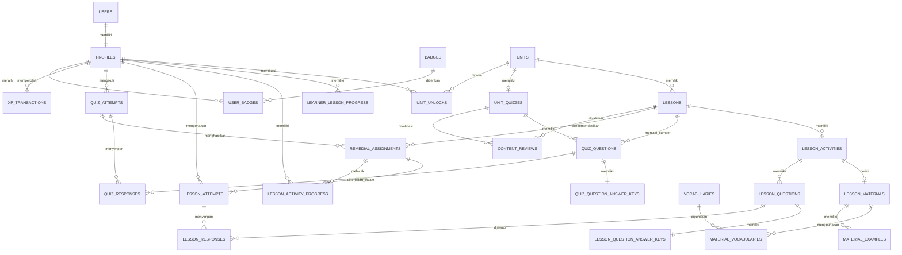

# DATABASE_SCHEMA.md — Pasanku

Dokumen ini mendefinisikan struktur database relasional **PASANKU** untuk **MySQL 8.0+ / PostgreSQL 15+** yang dikelola melalui **Laravel Migrations** dan **Eloquent ORM** pada arsitektur **Laravel + Inertia.js + React.js**.

---

## 1. Konvensi Database

- **Penamaan tabel & kolom:** `snake_case`, huruf kecil, nama tabel jamak (*plural*).
- **Primary Key:** `UUID` (`$table->uuid('id')->primary()`) pada seluruh entitas utama, dengan relasi `foreignUuid`.
- **Kolom JSON:** Menggunakan tipe `JSON` (kompatibel penuh dengan MySQL dan PostgreSQL melalui `$table->json(...)` dan Eloquent cast `'array'`).
- **Timestamp:** Seluruh kolom waktu menggunakan `TIMESTAMP` (`timestamps()`).
- **Integritas & Keamanan Data:** Menggunakan *foreign key constraints*, *unique composite indexes* untuk pencegahan duplikasi XP & progres, pemisahan tabel kunci jawaban (agar tidak pernah ikut ter-serialisasi ke Inertia props Learner), serta transaksi `DB::transaction()`.

---

## 2. Diagram ERD (Entity Relationship Diagram)

---

## 3. Daftar Tabel & Spesifikasi Kolom

### A. Pengguna & Autentikasi

#### 1. `users` (Autentikasi Bawaan Laravel)
| Kolom | Tipe Data | Keterangan |
| --- | --- | --- |
| `id` | UUID (PK) | Identitas unik akun autentikasi |
| `username` | VARCHAR(50) UNIQUE NULL | Username login (wajib untuk Admin/Validator, opsional/null untuk Learner) |
| `email` | VARCHAR(255) UNIQUE NULL | Alamat email login (wajib saat registrasi Learner, opsional untuk Admin/Validator) |
| `password` | VARCHAR(255) | Hash kata sandi (Bcrypt/Argon2) |
| `email_verified_at` | TIMESTAMP NULL | Waktu verifikasi email (opsional) |
| `remember_token` | VARCHAR(100) NULL | Token sesi remember me |
| `created_at`, `updated_at` | TIMESTAMP | Waktu pembuatan & pembaruan |

#### 2. `profiles`
Menyimpan profil aplikasi, peran RBAC, dan status aktif akun (termasuk aktivasi/penonaktifan Validator oleh Admin).
| Kolom | Tipe Data | Keterangan |
| --- | --- | --- |
| `id` | UUID (PK, FK -> `users.id`) | Relasi 1-to-1 ke tabel `users` |
| `full_name` | VARCHAR(150) | Nama lengkap pengguna |
| `role` | ENUM(`admin`, `validator`, `learner`) | Peran aplikasi (default `learner`) |
| `is_active` | BOOLEAN | Status aktif akun (default `true`, digunakan untuk manajemen Validator) |
| `created_at`, `updated_at` | TIMESTAMP | Waktu pembuatan & pembaruan |

---

### B. Kurikulum & Aktivitas Lesson

#### 3. `units`
| Kolom | Tipe Data | Keterangan |
| --- | --- | --- |
| `id` | UUID (PK) | Identitas unit |
| `title` | VARCHAR(200) | Nama unit |
| `description` | TEXT NULL | Deskripsi unit |
| `order_number` | INTEGER UNIQUE | Urutan unit (1–5) |
| `status` | ENUM(`draft`, `published`) | Status publikasi unit |
| `created_at`, `updated_at` | TIMESTAMP | Waktu pembuatan & pembaruan |

#### 4. `lessons`
| Kolom | Tipe Data | Keterangan |
| --- | --- | --- |
| `id` | UUID (PK) | Identitas lesson |
| `unit_id` | UUID (FK -> `units.id`) | Unit induk |
| `title` | VARCHAR(200) | Judul lesson |
| `description` | TEXT NULL | Pengantar/deskripsi lesson |
| `objective` | TEXT NULL | Tujuan pembelajaran |
| `order_number` | INTEGER | Urutan lesson dalam unit (1–5) |
| `content_version` | INTEGER | Nomor versi konten (default `1`) |
| `status` | ENUM(`draft`, `pending_review`, `changes_requested`, `approved`, `published`) | Status validasi & publikasi |
| `created_at`, `updated_at` | TIMESTAMP | Waktu pembuatan & pembaruan |

*Index Unik:* `(unit_id, order_number)`.

#### 5. `lesson_activities`
| Kolom | Tipe Data | Keterangan |
| --- | --- | --- |
| `id` | UUID (PK) | Identitas aktivitas |
| `lesson_id` | UUID (FK -> `lessons.id`) | Lesson induk |
| `activity_type` | ENUM(`material`, `exercise`) | Jenis aktivitas |
| `title` | VARCHAR(200) | Judul singkat aktivitas |
| `instruction` | TEXT NULL | Instruksi pengerjaan |
| `order_number` | INTEGER | Urutan tampil dalam lesson |
| `is_required` | BOOLEAN | Penanda aktivitas wajib (default `true`) |
| `created_at`, `updated_at` | TIMESTAMP | Waktu pembuatan & pembaruan |

#### 6. `lesson_materials`
| Kolom | Tipe Data | Keterangan |
| --- | --- | --- |
| `id` | UUID (PK) | Identitas bagian materi |
| `activity_id` | UUID UNIQUE (FK -> `lesson_activities.id`) | Relasi 1-to-1 ke aktivitas bertipe `material` |
| `content` | TEXT | Isi utama materi singkat |
| `explanation` | TEXT NULL | Kotak catatan / penjelasan tambahan |
| `estimated_duration` | INTEGER NULL | Estimasi waktu baca (detik) |
| `created_at`, `updated_at` | TIMESTAMP | Waktu pembuatan & pembaruan |

---

### C. Kosakata, Contoh, dan Kamus

#### 7. `vocabularies`
| Kolom | Tipe Data | Keterangan |
| --- | --- | --- |
| `id` | UUID (PK) | Identitas kosakata |
| `unit_id` | UUID NULL (FK -> `units.id`) | Unit pengenalan (mempermudah filter Kamus per unit) |
| `first_lesson_id` | UUID NULL (FK -> `lessons.id`) | Lesson pengenalan pertama |
| `pasan_word` | VARCHAR(200) | Kata/ungkapan Bahasa Pasan |
| `indonesian_meaning` | VARCHAR(255) | Arti dalam Bahasa Indonesia |
| `category` | VARCHAR(100) NULL | Kategori kosakata (sapaan, angka, keluarga, dll.) |
| `source_note` | TEXT NULL | Catatan/sumber referensi validasi bahasa |
| `validation_status` | ENUM(`draft`, `pending_review`, `approved`, `changes_requested`) | Status validasi kosakata |
| `created_at`, `updated_at` | TIMESTAMP | Waktu pembuatan & pembaruan |

#### 8. `material_vocabularies`
| Kolom | Tipe Data | Keterangan |
| --- | --- | --- |
| `id` | UUID (PK) | Identitas relasi |
| `material_id` | UUID (FK -> `lesson_materials.id`) | Bagian materi |
| `vocabulary_id` | UUID (FK -> `vocabularies.id`) | Kosakata terkait |
| `order_number` | INTEGER | Urutan tampilan kosakata |

#### 9. `material_examples`
| Kolom | Tipe Data | Keterangan |
| --- | --- | --- |
| `id` | UUID (PK) | Identitas contoh kalimat |
| `material_id` | UUID (FK -> `lesson_materials.id`) | Bagian materi |
| `pasan_text` | TEXT | Contoh kalimat Bahasa Pasan |
| `indonesian_translation` | TEXT | Terjemahan Bahasa Indonesia |
| `order_number` | INTEGER | Urutan contoh |

---

### D. Latihan Lesson & Kunci Jawaban

#### 10. `lesson_questions`
| Kolom | Tipe Data | Keterangan |
| --- | --- | --- |
| `id` | UUID (PK) | Identitas soal latihan |
| `activity_id` | UUID (FK -> `lesson_activities.id`) | Aktivitas bertipe `exercise` |
| `question_type` | ENUM(`mc_pasan_to_id`, `mc_id_to_pasan`, `matching`, `fill_blank`) | **4 jenis soal terstruktur** |
| `question_text` | TEXT | Teks pertanyaan |
| `question_data` | JSON | Data tampilan soal (opsi, pasangan kiri/kanan, atau teks rumpang) — tanpa kunci jawaban |
| `explanation` | TEXT NULL | Pembahasan jawaban yang tampil setelah pemeriksaan |
| `points` | DECIMAL(6,2) | Bobot maksimal soal |
| `order_number` | INTEGER | Urutan soal |

#### 11. `lesson_question_answer_keys`
| Kolom | Tipe Data | Keterangan |
| --- | --- | --- |
| `question_id` | UUID (PK, FK -> `lesson_questions.id`) | Relasi 1-to-1 ke soal latihan |
| `answer_key` | JSON | Kunci jawaban (hanya dibaca di server) |

---

### E. Quiz Unit & Kunci Jawaban

#### 12. `unit_quizzes`
| Kolom | Tipe Data | Keterangan |
| --- | --- | --- |
| `id` | UUID (PK) | Identitas quiz |
| `unit_id` | UUID UNIQUE (FK -> `units.id`) | Relasi 1-to-1 ke unit |
| `title` | VARCHAR(200) | Nama quiz unit |
| `description` | TEXT NULL | Deskripsi evaluasi |
| `passing_score` | DECIMAL(5,2) | Nilai minimum kelulusan (default `75.00`) |
| `content_version` | INTEGER | Versi konten quiz (default `1`) |
| `status` | ENUM(`draft`, `pending_review`, `changes_requested`, `approved`, `published`) | Status validasi & publikasi |
| `created_at`, `updated_at` | TIMESTAMP | Waktu pembuatan & pembaruan |

#### 13. `quiz_questions`
| Kolom | Tipe Data | Keterangan |
| --- | --- | --- |
| `id` | UUID (PK) | Identitas soal quiz |
| `quiz_id` | UUID (FK -> `unit_quizzes.id`) | Quiz induk (15–20 soal per quiz) |
| `primary_lesson_id` | UUID (FK -> `lessons.id`) | Lesson sumber utama untuk rekomendasi remedial |
| `question_type` | ENUM(`mc_pasan_to_id`, `mc_id_to_pasan`, `matching`, `fill_blank`) | **4 jenis soal terstruktur** |
| `question_text` | TEXT | Teks pertanyaan |
| `question_data` | JSON | Data tampilan soal (tanpa kunci jawaban) |
| `explanation` | TEXT NULL | Pembahasan soal |
| `points` | DECIMAL(6,2) | Bobot soal |
| `order_number` | INTEGER | Urutan soal |

#### 14. `quiz_question_answer_keys`
| Kolom | Tipe Data | Keterangan |
| --- | --- | --- |
| `question_id` | UUID (PK, FK -> `quiz_questions.id`) | Relasi 1-to-1 ke soal quiz |
| `answer_key` | JSON | Kunci jawaban quiz (hanya dibaca di server) |

---

### F. Validasi Konten

#### 15. `content_reviews`
| Kolom | Tipe Data | Keterangan |
| --- | --- | --- |
| `id` | UUID (PK) | Identitas riwayat validasi |
| `lesson_id` | UUID NULL (FK -> `lessons.id`) | Diisi jika yang divalidasi adalah Lesson |
| `quiz_id` | UUID NULL (FK -> `unit_quizzes.id`) | Diisi jika yang divalidasi adalah Quiz Unit |
| `content_version` | INTEGER | Nomor versi konten yang diajukan |
| `status` | ENUM(`pending`, `approved`, `changes_requested`) | Status pemeriksaan |
| `submitted_by` | UUID (FK -> `profiles.id`) | Admin pengaju |
| `reviewed_by` | UUID NULL (FK -> `profiles.id`) | Validator pemeriksa |
| `review_note` | TEXT NULL | Catatan hasil review / alasan revisi |
| `submitted_at` | TIMESTAMP | Waktu pengajuan |
| `reviewed_at` | TIMESTAMP NULL | Waktu keputusan Validator |

*Aturan Integritas:* Tepat salah satu dari `lesson_id` atau `quiz_id` wajib bernilai non-null.

---

### G. Progres Pembelajaran & Percobaan Lesson

#### 16. `unit_unlocks`
| Kolom | Tipe Data | Keterangan |
| --- | --- | --- |
| `id` | UUID (PK) | Identitas pembukaan unit |
| `user_id` | UUID (FK -> `profiles.id`) | Learner |
| `unit_id` | UUID (FK -> `units.id`) | Unit yang terbuka |
| `unlocked_at` | TIMESTAMP | Waktu unit terbuka |

*Index Unik:* `(user_id, unit_id)`.

#### 17. `learner_lesson_progress`
| Kolom | Tipe Data | Keterangan |
| --- | --- | --- |
| `id` | UUID (PK) | Identitas progres reguler |
| `user_id` | UUID (FK -> `profiles.id`) | Learner |
| `lesson_id` | UUID (FK -> `lessons.id`) | Lesson terkait |
| `completed_content_version` | INTEGER NULL | Versi konten yang telah diselesaikan |
| `best_score` | DECIMAL(5,2) NULL | Nilai terbaik |
| `status` | ENUM(`in_progress`, `completed`) | Status penyelesaian reguler |
| `completed_at` | TIMESTAMP NULL | Waktu pertama kali lulus |

*Index Unik:* `(user_id, lesson_id)`.

#### 18. `lesson_activity_progress`
| Kolom | Tipe Data | Keterangan |
| --- | --- | --- |
| `id` | UUID (PK) | Identitas progres aktivitas |
| `user_id` | UUID (FK -> `profiles.id`) | Learner |
| `lesson_id` | UUID (FK -> `lessons.id`) | Lesson terkait |
| `activity_id` | UUID (FK -> `lesson_activities.id`) | Aktivitas materi/latihan |
| `progress_type` | ENUM(`regular`, `remedial`) | Pemisahan konteks reguler dan remedial |
| `remedial_assignment_id` | UUID NULL (FK -> `remedial_assignments.id`) | Null jika reguler; terisi jika remedial |
| `status` | ENUM(`not_started`, `completed`) | Status aktivitas |
| `completed_at` | TIMESTAMP NULL | Waktu selesai |

#### 19. `lesson_attempts`
| Kolom | Tipe Data | Keterangan |
| --- | --- | --- |
| `id` | UUID (PK) | Identitas percobaan lesson |
| `user_id` | UUID (FK -> `profiles.id`) | Learner |
| `lesson_id` | UUID (FK -> `lessons.id`) | Lesson |
| `attempt_type` | ENUM(`regular`, `remedial`) | Jenis percobaan |
| `remedial_assignment_id` | UUID NULL (FK -> `remedial_assignments.id`) | Tugas remedial terkait |
| `attempt_number` | INTEGER | Nomor urut percobaan |
| `score` | DECIMAL(5,2) NULL | Nilai akhir (0–100) |
| `status` | ENUM(`in_progress`, `passed`, `failed`) | Status percobaan |
| `content_version` | INTEGER | Versi konten saat dikerjakan |
| `started_at` | TIMESTAMP | Waktu mulai |
| `completed_at` | TIMESTAMP NULL | Waktu selesai |

#### 20. `lesson_responses`
| Kolom | Tipe Data | Keterangan |
| --- | --- | --- |
| `id` | UUID (PK) | Identitas jawaban |
| `attempt_id` | UUID (FK -> `lesson_attempts.id`) | Percobaan lesson |
| `question_id` | UUID (FK -> `lesson_questions.id`) | Soal latihan |
| `response_data` | JSON | Jawaban yang dikirim pengguna |
| `is_correct` | BOOLEAN | Benar penuh (`true`) atau salah/parsial (`false`) |
| `earned_points` | DECIMAL(6,2) | Poin diperoleh (mendukung nilai parsial) |
| `submitted_at` | TIMESTAMP | Waktu dijawab |

---

### H. Percobaan Quiz & Rekomendasi Remedial

#### 21. `quiz_attempts`
| Kolom | Tipe Data | Keterangan |
| --- | --- | --- |
| `id` | UUID (PK) | Identitas percobaan quiz |
| `user_id` | UUID (FK -> `profiles.id`) | Learner |
| `quiz_id` | UUID (FK -> `unit_quizzes.id`) | Quiz unit |
| `attempt_number` | INTEGER | Nomor percobaan |
| `score` | DECIMAL(5,2) NULL | Nilai akhir (0–100) |
| `status` | ENUM(`in_progress`, `passed`, `failed`) | Status kelulusan |
| `content_version` | INTEGER | Versi quiz saat dikerjakan |
| `started_at` | TIMESTAMP | Waktu mulai |
| `completed_at` | TIMESTAMP NULL | Waktu selesai |

#### 22. `quiz_responses`
| Kolom | Tipe Data | Keterangan |
| --- | --- | --- |
| `id` | UUID (PK) | Identitas jawaban quiz |
| `attempt_id` | UUID (FK -> `quiz_attempts.id`) | Percobaan quiz |
| `question_id` | UUID (FK -> `quiz_questions.id`) | Soal quiz |
| `response_data` | JSON | Jawaban pengguna |
| `is_correct` | BOOLEAN | Status kebenaran |
| `earned_points` | DECIMAL(6,2) | Poin diperoleh |
| `submitted_at` | TIMESTAMP | Waktu dijawab |

#### 23. `remedial_assignments`
| Kolom | Tipe Data | Keterangan |
| --- | --- | --- |
| `id` | UUID (PK) | Identitas tugas remedial |
| `user_id` | UUID (FK -> `profiles.id`) | Learner |
| `quiz_attempt_id` | UUID (FK -> `quiz_attempts.id`) | Percobaan quiz gagal sumber rekomendasi |
| `lesson_id` | UUID (FK -> `lessons.id`) | Lesson yang direkomendasikan |
| `error_count` | INTEGER | Jumlah kesalahan pada lesson tersebut |
| `priority_order` | INTEGER | Urutan prioritas (1–3) |
| `content_version` | INTEGER | Versi lesson saat direkomendasikan |
| `status` | ENUM(`pending`, `in_progress`, `completed`) | Status pengerjaan remedial |
| `created_at` | TIMESTAMP | Waktu rekomendasi dibuat |
| `completed_at` | TIMESTAMP NULL | Waktu remedial lulus ($\ge 75$) |

---

### I. Gamifikasi (XP & Lencana)

#### 24. `xp_transactions`
| Kolom | Tipe Data | Keterangan |
| --- | --- | --- |
| `id` | UUID (PK) | Identitas transaksi XP |
| `user_id` | UUID (FK -> `profiles.id`) | Learner |
| `activity_type` | ENUM(`lesson`, `remedial`, `quiz`) | Sumber XP |
| `reference_id` | UUID | ID `lesson` (untuk lesson/remedial) atau ID `unit_quizzes` (untuk quiz) |
| `xp_amount` | INTEGER | Nilai XP (+10, +5, atau +25) |
| `created_at` | TIMESTAMP | Waktu pemberian XP |

*Index Unik Wajib (Anti-Duplikasi):* `UNIQUE(user_id, activity_type, reference_id)`.

#### 25. `badges` & `user_badges` (Mendukung Halaman Profil di `DESIGN.md`)
- **`badges`:** `id` (UUID PK), `code` (VARCHAR UNIQUE), `name` (VARCHAR), `description` (TEXT), `icon` (VARCHAR).
- **`user_badges`:** `id` (UUID PK), `user_id` (FK -> `profiles.id`), `badge_id` (FK -> `badges.id`), `awarded_at` (TIMESTAMP). *Index Unik:* `(user_id, badge_id)`.

---

## 4. Kontrak Format JSON Soal & Kunci Jawaban (4 Jenis Soal)

### 4.1 Pilihan Ganda (`mc_pasan_to_id` / `mc_id_to_pasan`)
- **`question_data`:** `{"options": [{"id": "A", "label": "..."}, {"id": "B", "label": "..."}, {"id": "C", "label": "..."}, {"id": "D", "label": "..."}]}`
- **`answer_key`:** `{"correct_option": "B"}`
- **`response_data`:** `{"selected_option": "B"}`

### 4.2 Mencocokkan Pasangan (`matching`)
- **`question_data`:** `{"left_items": [{"id": "L1", "text": "..."}], "right_items": [{"id": "R1", "text": "..."}]}`
- **`answer_key`:** `{"pairs": {"L1": "R2", "L2": "R1", "L3": "R3"}}`
- **`response_data`:** `{"pairs": {"L1": "R2", "L2": "R3", "L3": "R1"}}` *(Penilaian parsial: $\text{earned\_points} = \frac{\text{jumlah\_benar}}{\text{total\_pasangan}} \times \text{points}$)*

### 4.3 Melengkapi Ungkapan (`fill_blank`)
- **`question_data`:** `{"template": "___ kabar?", "choices": [{"id": "A", "label": "..."}, {"id": "B", "label": "..."}]}`
- **`answer_key`:** `{"correct_choice": "A"}`
- **`response_data`:** `{"selected_choice": "A"}`