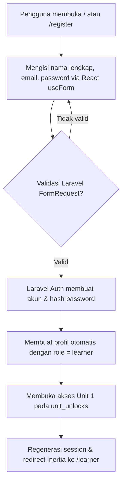
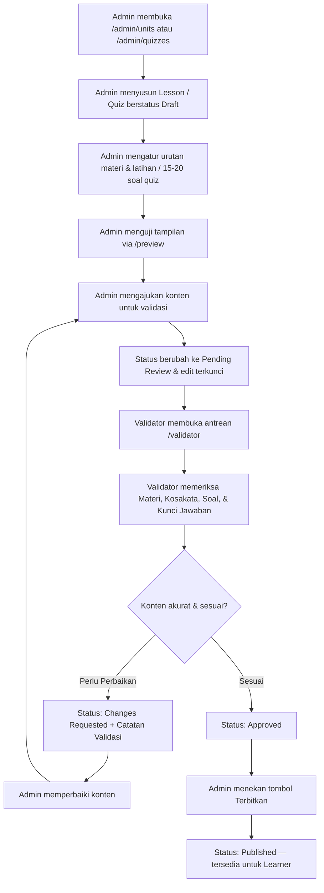
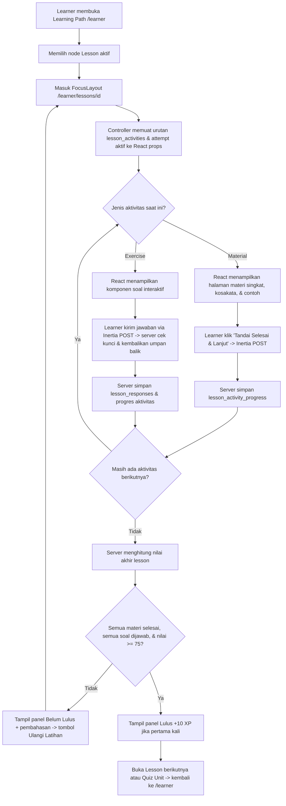
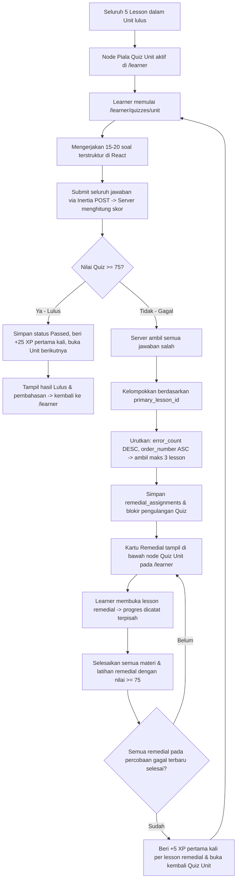

# USER_FLOW.md — Pasanku

Dokumen ini memetakan seluruh alur perjalanan pengguna (*User Journeys*) untuk **Learner**, **Admin**, dan **Validator** di aplikasi **PASANKU** berbasis **Laravel + Inertia.js + React.js**.

---

## 1. Alur Autentikasi & Registrasi Mandiri (Learner)

**Catatan Alur Login (`/login`):**
- Setelah kredensial diverifikasi dan `profiles.is_active == true`, sistem mengarahkan pengguna berdasarkan peran:
  - `learner` -> `/learner`
  - `validator` -> `/validator`
  - `admin` -> `/admin`
- Jika gagal, tampilkan pesan error generik tanpa membocorkan apakah email terdaftar atau tidak.

---

## 2. Alur Pembuatan & Validasi Konten (Admin & Validator)

**Alur Perubahan Konten Terbit:**
1. Admin memilih mengedit konten berstatus `published`.
2. Sistem otomatis menaikkan `content_version` (+1) dan mengembalikan status menjadi `draft`.
3. Konten wajib diajukan kembali ke Validator sebelum versi baru diterbitkan.
4. Unit yang sudah terbuka bagi Learner tetap terbuka.

---

## 3. Alur Pembelajaran Lesson (Learner)

**Catatan Percobaan Ulang Lesson Gagal:**
- Sistem membuat `lesson_attempts` baru tanpa menghapus riwayat lama.
- Materi yang sudah ditandai selesai pada konteks reguler tetap tercatat selesai sehingga Learner cukup mengulang latihan (namun tetap dapat membuka ulang materi jika ingin).

---

## 4. Alur Quiz Unit, Rekomendasi Adaptif, & Remedial (Learner)

---

## 5. Alur Fitur Pendukung Learner

### 5.1 Kamus (`/learner/kamus`)
1. Learner membuka tab `Kamus`.
2. Mengetik kata Bahasa Pasan atau Bahasa Indonesia di kolom pencarian (*debounce* React memicu `router.get` dengan `preserveState: true, replace: true`) dan/atau memilih chip filter unit (`Semua`, `Unit 1`, `Unit 2`, `Unit 3`, `Unit 4-5`).
3. Sistem menampilkan kartu kosakata tervalidasi beserta arti, kategori, contoh kalimat, dan catatan bahasa.

### 5.2 Papan Skor (`/learner/papan-skor`)
1. Learner membuka tab `Papan Skor`.
2. Sistem menampilkan podium 3 teratas dan daftar peringkat berdasarkan akumulasi Total XP.
3. Baris Learner yang sedang login disorot dengan latar `--color-surface-highlight`.

### 5.3 Profil (`/learner/profil`)
1. Learner membuka tab `Profil`.
2. Melihat identitas, kartu Level & progres XP, daftar Lencana (`Badge`), riwayat percobaan Quiz Unit, dan riwayat transaksi XP.
3. Dapat menekan tombol `Keluar` (`router.post('/logout')`) untuk mengakhiri sesi.

---

## 6. Alur Mode Pratinjau (`/preview`) — Admin & Validator

1. Admin atau Validator mengklik menu `Pratinjau` dari sidebar atau top bar mobile.
2. Sistem menampilkan Learning Path dengan banner sticky amber `Mode Pratinjau: progres tidak disimpan`.
3. Pengguna dapat memilih filter `Semua Status` (termasuk `draft` & `pending_review`) atau `Hanya Terbit`.
4. Pengguna bebas membuka unit, lesson, atau quiz mana saja tanpa batasan kunci urutan dan menguji soal serta penilaian secara *stateless* (state langkah di React & pengecekan skor tanpa menulis ke tabel progres atau XP).
5. Klik `Keluar Pratinjau` untuk kembali ke dashboard peran masing-masing.